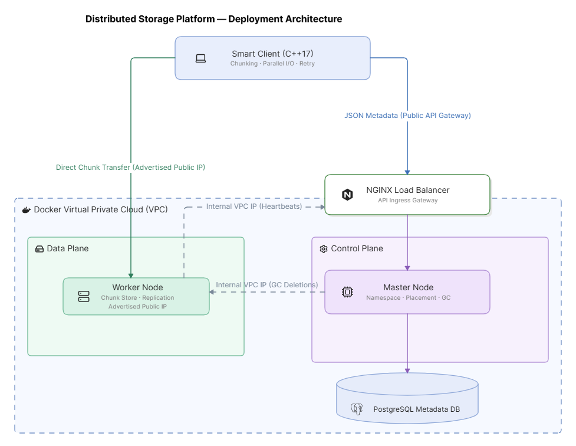
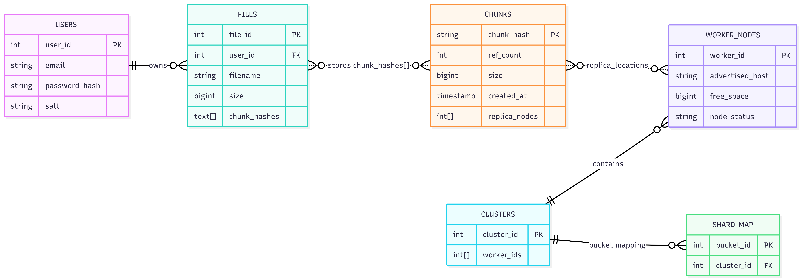
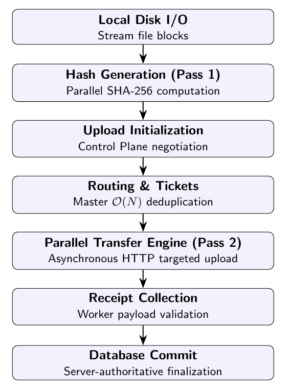
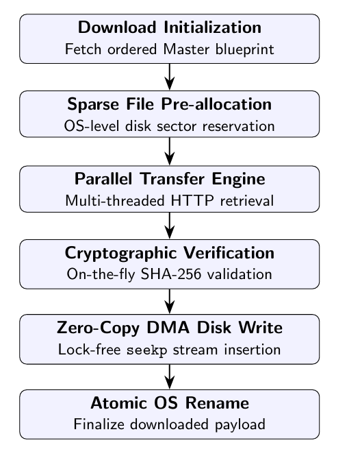
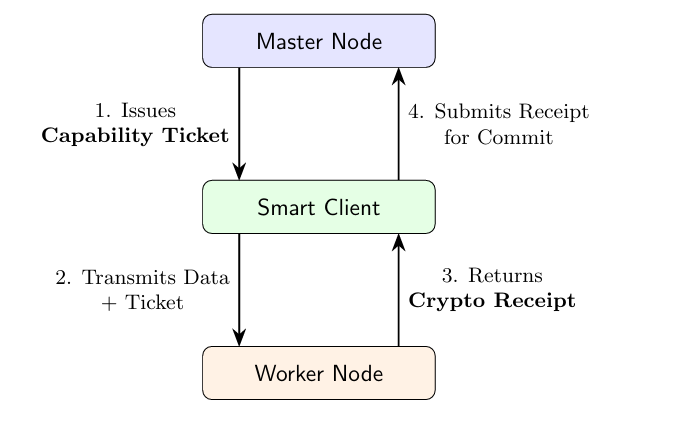
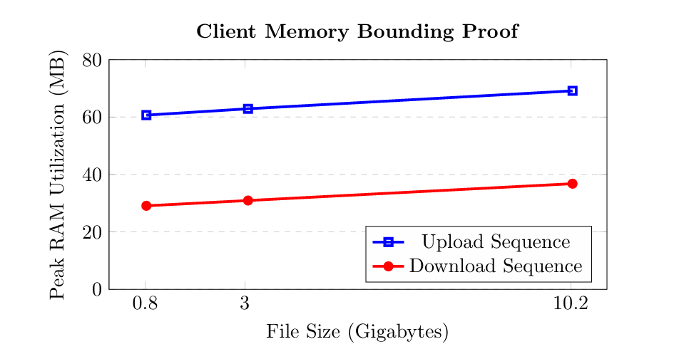

# DSE-Core: Zero-Trust Distributed Object Storage Platform

*A Zero-Trust Distributed Object Storage Platform written in Modern C++17*

This project is a distributed object storage platform written in modern C++17. It separates metadata management from binary data transfer through a decoupled Control Plane and Data Plane while introducing a Smart Client that performs edge-side deduplication, bounded-memory streaming, and resumable parallel transfers.

**Languages & Technologies:** C++17 • PostgreSQL • Docker • OpenSSL • NGINX

## Features

### Storage
- **Global CAS Deduplication**
- **AES-256 Encryption**
- **Parallel Uploads & Downloads**

### Reliability
- **Append-only Resumability**
- **Automatic Garbage Collection**

### Architecture
- **Active-Active Masters**
- **Zero-Trust Upload Authorization**

---

## Quick Start

### 1. Launch Multi-Node Cluster
Ensure Docker Desktop is running, then boot the 7-node cluster:
```bash
docker compose up -d
```
The cluster runs 2 active-active Master nodes behind an NGINX Layer-7 load balancer on `http://localhost:8088`, PostgreSQL 15 on `localhost:5433`, and 4 storage worker nodes on ports `9001-9004`.

### 2. Run End-to-End Test Suite
Run the automated Python test suite to verify cluster bootstrap, capability tickets, worker replication, zero-copy deduplication, and byte-for-byte SHA-256 retrieval verification:
```bash
python tests/main.py
```

---

## Repository Structure

```text
client/          Smart Client implementation
master/          Control Plane
worker/          Data Plane
common/          Shared utilities
docker/          Multi-node deployment
docs/            Report and architecture diagrams
```

---

## Table of Contents
1. [The Importance of Edge-Side Deduplication](#the-importance-of-edge-side-deduplication)
2. [Overall System Architecture](#overall-system-architecture)
3. [Metadata Schema](#metadata-schema)
4. [The Control Plane (Master Server)](#the-control-plane-master-server)
5. [The Data Plane (Worker Nodes)](#the-data-plane-worker-nodes)
6. [The Smart Client: Orchestration & State](#the-smart-client-orchestration--state)
7. [Security & Zero-Trust Architecture](#security--zero-trust-architecture)
8. [Experimental Methodology & Results](#experimental-methodology--results)
9. [Future Work & Production Scaling](#-future-work--production-scaling)

---

## The Importance of Edge-Side Deduplication

A core optimization in modern storage is deduplication. This is achieved via **Content-Addressed Storage (CAS)**. Files are sliced into fixed-size chunks (e.g., 1MB), and each chunk is identified by a cryptographic hash (e.g., SHA-256) of its contents. Crucially, this optimization extends beyond identical files to enable sub-file (cross-file) deduplication. 

However, if the central server is forced to compute these hashes, it must still absorb the network bandwidth of receiving the file first. By shifting the CAS deduplication logic to the edge (the client device), the system achieves significant bandwidth conservation. The client hashes the file locally and consults the server with a blueprint of hashes. If the chunks already exist globally, the network transfer is bypassed.

## Overall System Architecture

The ecosystem is orchestrated via three distinct subsystems interacting over a Virtual Private Cloud (VPC). The architecture logically separates the Control Plane, the Data Plane, and the Smart Client, while enforcing strict network boundaries.

<p align="center">
  
</p>

**Typical upload workflow:** Smart Client → Master (routing & tickets) → Worker Nodes (parallel upload) → Master (receipt commit).

The Control Plane operates exclusively via an HTTP API gateway (NGINX) deployed at the VPC edge, protecting the backend PostgreSQL database from external exposure. Worker Nodes are provisioned independently in the Data Plane, utilizing Split-Horizon routing to expose public chunk-transfer endpoints to the client while maintaining private, internal telemetry links with the Master nodes.

## Metadata Schema

The Control Plane persists all metadata in PostgreSQL. Binary payloads are never stored in the database; only metadata describing files, chunks, routing, replication state, and cluster topology are maintained. The schema is highly normalized to separate user-visible file metadata from globally deduplicated chunk metadata.

<p align="center">
  
</p>

Key tables include:
- **`users`**: Primary authentication and identity repository.
- **`files`**: Maps user-visible logical files to their respective owners. Leverages a native PostgreSQL array field (`chunks TEXT[]`) to preserve sequential ordering.
- **`chunks`**: The central dictionary driving global deduplication (`chunk_hash`, `ref_count`).
- **`worker_nodes`** and **`clusters`**: Tracks physical storage infrastructure and logically groups nodes.
- **`shard_map`**: Defines deterministic placement of data, mapping logical hash boundaries to physical hardware blocks.

## The Control Plane (Master Server)

The Control Plane consists of stateless C++17 REST servers behind an NGINX Layer-7 Load Balancer. Crucially, *Master nodes never handle binary file payloads*. They are exclusively responsible for orchestrating metadata routing, managing concurrent state, and scaling the cluster.

- **Metadata Orchestration**: Resolves routing blueprints. Deduplicates missing chunks effectively across concurrent users.
- **Deterministic Cluster Placement & Routing**: Employs deterministic hash placement (modulo bucket counting) allowing O(1) coordination-free placement and stable active-active master scalability.
- **Concurrency and Deadlock Prevention**: Employs alphabetization of client hash arrays to guarantee deterministic lock acquisition during PostgreSQL `SELECT ... FOR UPDATE`, preventing cyclic database deadlocks.
- **Distributed Garbage Collection**: An autonomous Garbage Collection (GC) daemon manages orphaned data using `SKIP LOCKED` semantics without blocking stateless Master nodes.
- **Cluster Scaling**: Designed for zero-downtime horizontal scaling via `Add Cluster` and `Replace Cluster` strategies.

## The Data Plane (Worker Nodes)

Worker Nodes are responsible for secure binary storage. They expose public endpoints to the client but are entirely independent, dumb storage silos tasked exclusively with secure disk I/O.

- **Cryptographic Verification and Encryption**: Performs on-the-fly SHA-256 computation on incoming TCP streams. Validated payloads are symmetrically encrypted using AES-256-CBC at rest.
- **Concurrent I/O and Disk Overallocation Defense**: Implements an OS-level file pre-allocation mechanism (`std::filesystem::resize_file` within a mutex) before initiating physical disk I/O to prevent Time-Of-Check to Time-Of-Use (TOCTOU) race conditions during disk allocation.
- **Receipt Generation:** Returns cryptographically signed upload receipts that are later validated by the Master before metadata commit.

## The Smart Client: Orchestration & State

The proposed client operates as a robust edge runtime, taking on the computationally heavy responsibilities of cryptographic hashing, deduplication discovery, transfer scheduling, bounded-memory streaming, and crash-consistent state recovery.

### Upload Pipeline Architecture

<p align="center">
  
</p>

- **Two-Pass Streaming & O(N) Matching**: In Pass 1, generates hashes without retaining huge memory buffers. In Pass 2, utilizes a Two-Pointer Algorithm to bypass globally deduplicated bytes, jumping directly to target bytes via `std::ifstream::seekg`.
- **Producer-Consumer Memory Bounding (Semaphores)**: Utilizing advanced C++17 Semaphore primitives, the client establishes strict hardware-level backpressure barriers. A CPU-bound semaphore initialized with 32 permits blocks the NVMe reader if 32 chunks are queued for hashing, preventing RAM flood. A subsequent network-bound semaphore initialized with 16 permits blocks the disk from extracting payloads until active HTTP sockets successfully flush existing bytes over the network.
- **Crash-Consistent Resume Engine**: A dynamic Append-Only log (`completed.log`) batches successful transfers, enabling O(1) Index Bitset construction upon resume, drastically reducing write amplification.

### Download Pipeline Architecture

<p align="center">
  
</p>

- **Zero-Copy DMA & HTTP Dispatch**: Pre-allocates sparse temporary files (`.dse_download`) using `std::fstream::seekp` to prevent OS memory bloat. Multiple threads write bytes directly to the predetermined file offsets.
- **Lock-Free Verification**: Uses `std::vector<uint8_t>` instead of bit-packed bools for memory states, completely removing data races during concurrent hash validations.
- **TOCTOU Defense**: Evaluates exact `last_write_time` and `file_size` during initialization and resume. If modified, local states are purged safely.

## Security & Zero-Trust Architecture

The architecture inherently operates under a Zero-Trust model. 

<p align="center">
  
</p>

- **Key Management**: Strict separation between `SESSION_SECRET` (Master), `CLUSTER_SECRET` (Master/Worker), and `AES_KEY` (Worker).
- **Authentication**: Stateless session tokens using HMAC-SHA256 and constant-time string comparisons limit timing attacks.
- **Capability Tickets**: Master Node acts as a certificate authority, generating HMAC-based capability tickets (expiring timestamps) to prevent Storage Denial of Service (DoS) against Worker SSDs.
- **Byzantine Client Defense**: Zero-trust on payloads, requiring continuous cryptographic evaluation at the edge.
- **Cryptographic Receipts**: A robust protocol mandating server-authoritative sizing ensures malicious clients cannot forge upload sizes ("Ghost Commits").

## Experimental Methodology & Results

Telemetry gathered against a native Windows C++17 client against a multi-node backend Docker VPC showcased the efficiency of the architecture. Additional benchmarks are available in the report.

### Upload & Download Performance

In a client-side replication architecture, upload throughput decreases as the replication factor increases. 

**Table: Upload 825 MB Video (myvideo.mp4)**
| Nodes | Time (s) | Speed (MB/s) | Hash (s) | Trans. (s) | Peak (MB) | Avg (MB) | Dedup (%) |
|-------|----------|--------------|----------|------------|-----------|----------|-----------|
| 1 Node| 5.675 | 145.442 | 1.090 | 4.308 | 60.67 | 44.71 | 0.000% |
| 2 Nodes| 10.282| 80.278 | 1.299 | 8.716 | 60.91 | 51.31 | 0.000% |
| 3 Nodes| 14.913| 55.345 | 1.279 | 13.366 | 61.06 | 53.68 | 0.000% |
| 4 Nodes| 21.671| 38.087 | 1.573 | 19.774 | 61.65 | 55.16 | 0.000% |

**Table: Download Telemetry Comparison (Single Node Replica Retrieval)**
| File Name | Size (MB) | Time (s) | Speed (MB/s) | Meta (s) | Trans. (s) | Peak (MB) | Avg (MB) |
|-----------|-----------|----------|--------------|----------|------------|-----------|----------|
| myvideo.mp4| 825.38 | 5.353 | 154.196 | 0.063 | 5.289 | 29.10 | 26.78 |
| random_3GB| 3072.00 | 18.955 | 162.071 | 0.142 | 18.811 | 30.93 | 29.14 |
| test_3gb | 3072.00 | 18.119 | 169.547 | 0.118 | 18.000 | 30.92 | 28.58 |
| random_10gb| 10240.00| 75.917 | 134.884 | 0.706 | 75.208 | 36.79 | 30.98 |

### Memory Footprint

<p align="center">
  
</p>

*Payload memory footprint remains bounded across increasing file sizes (up to 10.24 GB), demonstrating the effectiveness of semaphore-based backpressure and streaming I/O algorithms.*

- **Network Limits vs CPU Limits**: Cryptographic hashing and metadata negotiations are dwarfed by the physical TCP transfer phase (network boundary). 
- **Deduplication Impacts**: Identical chunks and globally available data almost entirely bypass transfer times, drastically accelerating repeats.
- **Download Asymmetry**: Sequential lock-free writes on Upload are observably faster than concurrent random access allocations for Downloads on typical hardware.

## 🔮 Future Work & Production Scaling

While the current prototype handles deterministic scaling well, the following architectural upgrades would transition the platform into an enterprise-grade production environment:

- **Stateless Storage Gateways**: Route ingress traffic through a Network Load Balancer to a fleet of Stateless Data Gateways, reducing client upload bandwidth and shifting replication traffic onto the high-speed internal storage network.
- **Configurable Write Quorums**: Transitioning from strict synchronous replication to Dynamo-style configurable quorum writes (W + R > N) paired with background anti-entropy daemons.
- **Content-Defined Chunking (CDC)**: Migrating the edge slicer from fixed 1MB boundaries to Rabin Fingerprinting to ensure byte-shifting resilience.

---

## Conclusion

This platform demonstrates that moving hashing, deduplication, and transfer orchestration to the client enables a scalable, memory-bounded distributed storage architecture while maintaining strong security guarantees through a Zero-Trust protocol.

---
